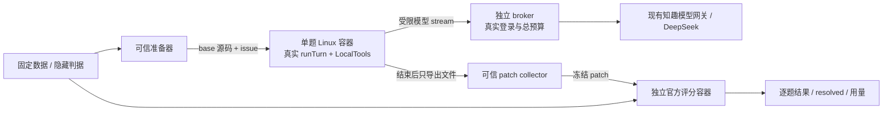

# 知趣 CLI 仓库级评测方案

日期：2026-10-13。状态：**设计完成，尚未执行模型评测**。本轮只固定公开数据、选题和协议；容器运行器、转发器与评分集成仍需实现和验收。

2026-10-14 的实际准备及个人电脑继续步骤见 [准备记录](repository-pilot-20261014/README.md)。已确认 ¥50 额度，但用户因 IT 禁止下载 Docker 停止公司电脑环境准备；真实模型调用0、费用0。实际运行配置采用兼容经典数据格式的官方 v3.0.17，本文件下方保留最初设计版本记录。

## 要回答的问题

HumanEval 的 156/164（95.12%）证明了知趣 CLI + DeepSeek 在基础 Python 函数实现上的表现。新评测观察真实仓库中的 issue 定位、跨文件修复、公开测试、回归保护和长任务完成能力，才适合逐步讨论工程水平。

主集采用官方 **SWE-bench Verified**。先跑固定 **10 题 pilot**，再根据实际费用和环境稳定性另行冻结 50 题；最后才考虑完整 500 题。小样本不得标为完整 Verified 排名。另设计 **Zhiqu-JavaJS-6** 补充集，观察本项目技术栈，分数单列。

所有模型题每题一次 agent episode。允许 agent 自行检查和修正；不提供最终隐藏测试反馈，不重新生成答案后择优。

## 已固定与仍待固定

| 项目 | 固定值 / 状态 |
|---|---|
| 数据集 | `princeton-nlp/SWE-bench_Verified`，`test`，500 题 |
| 数据 revision | `c104f840cc67f8b6eec6f759ebc8b2693d585d4a` |
| 数据文件 | `data/test-00000-of-00001.parquet`；原始字节哈希见 [selection.json](repository-pilot-20261013/selection.json) |
| 官方 harness | `SWE-bench/SWE-bench`，commit `02e7a74ffd0b707aab73d203fe87bdc7c76afc8e` |
| 被测 CLI | commit `86a4a3c16a226c7464b3023d2bb63ad5c3d810d9` 的 `zhiqu-cli/`，Git tree `693428159f05c12194fb0090db4c013165fce2ed` |
| 模型 | 现有 DeepSeek ID 1，`deepseek-v4-pro`，思考 OFF；每个 stream 核对实际模型和上下文 |
| 题目 | 五个仓库各两题，精确 ID / base / issue 哈希见 selection.json |
| 运行限制 | 一次 episode，60 轮 / 1800 秒；单命令 180 秒；生成和评分各并发 1 |
| 请求节奏 | 全部运输层请求合计至多 50/min，起始间隔至少 1200ms，重试也计入；每题至多 200 次请求 |
| 生成 Node | 拟固定 Linux x86_64 Node 24.19.0；Linux 二进制 SHA 尚待环境准备时固定，不能复用 macOS 二进制 |
| Python / 依赖 | 按官方任务环境固定解释器、包锁与解释器路径；不强迫旧仓库使用宿主机 Python |
| 镜像 | 每题生成和评分镜像分别记录 immutable digest，尚未构建 / 拉取 |
| 适配器 | 仓库 worker / broker / patch collector 尚未实现；实现后先冻结源码、配置和隔离策略哈希 |
| 费用 | 本轮无模型调用；pilot 人民币预算和输入 / 输出 token 上限未填写，执行入口必须拒绝空值 |

[protocol.json](repository-pilot-20261013/protocol.json) 是机器可读的设计配置，`execution_ready=false`。它不是可直接启动评测的运行配置。正式生成前生成完整 `run-manifest.json`，任何待固定项为空都应拒绝开始。

## 选题与扩展

pilot 覆盖 `django/django`、`sympy/sympy`、`pytest-dev/pytest`、`psf/requests`、`scikit-learn/scikit-learn`。
在上述固定 revision 内，只读取 `instance_id / repo / base_commit / problem_statement` 四列。组内按 `SHA256("zhiqu-sweverified-v1\n" + instance_id)` 升序，ID 作为同哈希的次序判据，各取两题。
选题与隐藏 patch、测试数、修复大小、模型表现无关；准备困难也不能偷偷换题。保留 500 行公开索引的规范化哈希、各仓库数量、精确 10 个 ID 与选择脚本哈希，后续能独立重建。

| 仓库 | Verified 题数 | 固定 pilot ID |
|---|---:|---|
| django/django | 231 | `django__django-12308`、`django__django-15987` |
| sympy/sympy | 75 | `sympy__sympy-23950`、`sympy__sympy-20154` |
| pytest-dev/pytest | 19 | `pytest-dev__pytest-10356`、`pytest-dev__pytest-5840` |
| psf/requests | 8 | `psf__requests-1921`、`psf__requests-1724` |
| scikit-learn/scikit-learn | 32 | `scikit-learn__scikit-learn-10297`、`scikit-learn__scikit-learn-13496` |

未来 50 题采用同 revision、同 hash，按各仓库题量比例分层：先取各仓库 `floor(50 × n_repo / 500)`，剩余配额按小数余数降序、repo 字典序破同分；各组取前 k 个。在模型调用前写出精确清单。它是一次新的预注册运行，分数单列，不与 pilot 混合，也不能称两次独立样本——清单可能重叠。

公开提交只保存 ID、base 与 issue 哈希，不提交题目全文、隐藏测试或原始 parquet。运行时由可信准备器从固定数据生成公开任务。分享 issue、代码和候选时分别核对数据集与各仓库许可。

## 生成、网关与评分的边界

生成 checkout 从 `base_commit` **导出源码**，只含当时已有的文件和公开测试。不给包含未来修复的完整 `.git`、远端、round 修复记录、评分脚本、gold patch、test patch、`FAIL_TO_PASS`、`PASS_TO_PASS` 或 `hints_text`。父进程在隔离目录保存 base 用于收 diff；生成目录不需要 `.git`。

官方 instance 镜像可能含仓库历史、构建脚本、评估目录和任务相关信息。**不能拿它作为生成镜像或其祖先层**。生成镜像从未接触 gold / test patch 的公开依赖环境加 base archive 构建；不靠删文件来证明历史层没有答案。生成前审计所有镜像层与最终可读文件，不含 Git 历史、下载缓存中的未来版本源码、隐藏 test state、其他题目录和评估材料；记录清单与探针。评分镜像保留官方需要的状态，两者不共用可写层或评分卷。

真实 worker 导入固定 `runTurn`、`BUILTIN_SYSTEM_PROMPT`、`LocalTools`、默认命令 / 文件 guard 和生产 SSE / Api 实现。协议只设置可配置的轮次、超时与模型，不改工具能力以提高成绩。仓库中的公开维护说明可照常读取；用户个人 Skills、MCP、远程办公工具、存档和宿主机配置不提供。

生产命令清单不含 `git`、`docker`、`bash`、裸 `pytest`。可用 `python -m pytest`、`python tests/runtests.py` 或已有 Node / npm / Maven 脚本。父进程负责 Git diff 和官方评分。`LocalTools` 清空子命令继承环境，PATH 仅含所选命令目录和系统目录：准备时必须把真正的任务 Python 及依赖安装到固定可解析位置，实测清空环境后的命令，不能只在激活 conda 的 shell 中测通。

### 模型转发的具体方案

task 容器接单题专属 Docker internal network，broker 独立容器同时接该网络与受控网关网络。task 的生产 Api 连接 broker 的固定私有 IP / 端口；broker 只接受 **POST `/api/harness/model/stream`**，每本账固定一个已批准的模型 ID（ID 6，或补跑时的 ID 1，都是 deepseek-v4-pro），拒绝其他路径、方法、模型、重定向和管理请求。真实登录只在 broker 中；worker 得到短期、只属于本题的 capability，通过 stdin 传入，停止时撤销。

`internal` 网络和宿主机 DOCKER-USER 规则均不能独自保证 task 对宿主机的隔离。task 启动在等待状态，由可信临时 policy 容器在共享的 task 网络 namespace 内设置 **OUTPUT 默认 DROP**：仅允许固定 broker IPv4 / stream 端口、已有连接及公开测试需要的 loopback；先拒绝 TCP / UDP 53（含 Docker 的 `127.0.0.11` DNS），IPv6 OUTPUT 全拒绝。policy 容器只在配置时持有 NET_ADMIN，不挂候选卷，设置后移除；task 自己始终没有 NET_ADMIN。真实 agent 在规则和无模型探针通过后才启动。broker 不发布宿主机端口、管理面只在独立控制通道，关闭 IP forwarding。固定路由、源 / 目标、端口和规则哈希；配置或探针失败时不运行模型。

本机 `127.0.0.1:47615` 不能直接当作 Linux 容器或远程机器的网关。本地 broker 要用实测可达的宿主 relay 地址；若用远程 Linux，则经已配置的受控通道访问现有服务，或使用可用的知趣网关。执行前真实验证 stream 与拒绝探针，不能直接把桌面服务改成公网监听。

Python / Node 脚本可以运行任意代码，生产命令白名单不是 OS 沙箱。同 UID 子命令也可能读取 worker 内存或 capability。因此 broker 不信任 task：每题独立限额，所有收到的请求都入账，capability 不能访问真实办公 API、其他题或无限调用。账本与 worker 请求数不一致记录 `unattributed_model_request`，按冻结协议判完整性失败；不把额外调用藏在 ctx.usage 外。取消时由宿主机停止整个 task 容器 / cgroup，撤销 capability；不能仅杀 Node PID。worker 和会话可能被子命令扰动，正式账本、计时、patch 与退出状态由父进程和 broker 收集；进程内日志只作诊断证据。

task 使用非 root、只读系统与只读 CLI/runtime、独立源码卷和 tmpfs，`cap-drop=ALL`、`no-new-privileges`、默认 seccomp、明确 PID / CPU / RAM / 临时空间限制；不使用 privileged、host network / PID、Docker socket、宿主机 HOME、真实数据库 / Wiki 或云凭证挂载。依赖预装，模型期间禁外网下载。资源数在试运行前固定，OOM 不自动归为代码断言失败。

## Patch 收集和官方评分

容器停止、进程清理和源码卷冻结后，父进程对 base 和最终文件作 diff，收集修改 / 删除 / 新增文件，排除 `.zhiqu`、构建产物与协议指定的自检临时文件。排除规则在调用前固定并记录被排除项；不得悄悄删除失败的修改来改善成绩。

拒绝绝对路径、路径逃逸、设备文件、指向仓库外的软链、异常体积和评分器路径写入。public test 的修改可保留；hidden test patch、runner 与 expected test 清单由评分器控制。疑似禁用断言、改评分器或让测试空跑时记录完整性失败；不能把空扫或 skip 当通过。额外完整性检查单列于官方结果，不能冒称它就是上游评分逻辑。

输出官方 predictions JSONL：`instance_id / model_name_or_path / model_patch`。保存 base tree、原始 diff、提交 patch 的 SHA-256 与完整性判据。repository patch 不要求保留原文件的逐字前缀；普通空行变化不再触发 HumanEval completion 提取失败。

评分从全新固定 base 开始，仅应用冻结候选 patch，再由固定官方 harness 应用 test patch、运行选定测试并读官方逐题 report。评分器从固定 revision 的控制侧私有快照读取隐藏字段；不能只向 harness 传数据集名而让它读取 latest。评分容器同样隔离，没有模型、真实凭证或生成日志访问权；控制脚本不放候选可写目录。评分完不反馈隐藏日志给 agent。

每份不同 patch 使用新的 `run_id`，名称包含协议指纹和 patch 集合哈希，输出目录独立。官方缓存按 `run_id + instance_id` 识别，不能用同 ID 换 patch 后复用已有结果。[官方评估说明](https://www.swebench.com/SWE-bench/guides/evaluation/)

## 环境控制与计分

正式 episode 前，对固定十题全部完成这些控制。empty / gold、文件 / 网络拒绝和生命周期控制不调用付费模型；先用假 stream 验证 worker / broker 协议，再在明确预算后单独做合法真实模型校准，调用和费用另行入账，不计正式题成绩：

1. empty patch：官方 `FAIL_TO_PASS` 中出现实际测试失败，记录测试名和断言；安装 / 收集 / import Errors 不能替代这个红。
2. gold patch：官方 fail-to-pass 与 pass-to-pass 均满足，完整评分 report 可解析；它仅进入隔离评分环境。
3. generation smoke：真正 `LocalTools` 在清空环境后能读写 base 与运行公开测试；source / runtime 只读，隐藏目录和其他题不能读取。
4. isolation smoke：从 task 实际网络 namespace 访问宿主 IP / host.docker.internal、外网 / Docker DNS / IPv6、其他题、办公 API、broker 管理路径、错误 model / capability 均被拒绝；合法真实 stream 在预算确定后单独连通、核对模型并入账。
5. lifecycle smoke：超时、中断、fork 后代、输出洪泛和取消时正在 stream，全部容器进程被回收，capability 撤销，账本无漏记。
6. grader integrity：外目录读写、候选修改控制请求、跳过 / 空收集 / 改 runner 的负例失败；同一 patch 重评分可复现，无旧缓存混入。

主指标为 **官方 resolved / 固定 N**，同时给出逐题官方判据与错误分类。模型正常结束、有补丁或公开测试通过都不能替代 resolved。超时、轮次耗尽、缺 patch、协议错误和官方测试失败保留分母；不替换任务，也不对隐藏结果做模型补救。

基础设施错误（镜像、平台、评分器、外部网关持续不可达）先定位；修复后只重评原冻结 patch。生成中断已有有效 patch也保留并评分，记录中断状态；没有候选则记未完成，不重生成择优。仍有未完成评分时只报告 resolved 个数 / 待评数，不发布最终能力百分比。预算耗尽使固定题集未完成时标 **budget-stopped incomplete run**，不按已完成小分母报成功率。

同时单列公开测试执行率、完整构建、预定完整 suite 与 base 的差异、文件数、工具拒绝、超时、OOM、agent / 模型 / 网关失败、耗时及用量。SWE-bench 官方 selected tests 不是全仓 suite：完整 suite 超时和基线失败单列，不偷换 resolved 定义。

## Java / JS 六题补充集

| 槽位 | 技术栈 / 工作形状 | 隐藏验收重点 |
|---|---|---|
| J1 | Java 知识页更新，controller / service / mapper | stale version、并发、清空字段与真实更新行数 |
| J2 | Java 模型网关 / SSE | 实际模型、错误传播、权限链、断流终态 |
| C1 | CLI JS 流与重试 | 截断、断流、输出前后重试和用量 |
| C2 | CLI JS 文件与进程 | 跨文件修改、先读后写、取消后的子孙进程 |
| F1 | 前端 JS 共享状态 / 业务时钟 | 跨零点、时区、多个页面 / 标签页 |
| F2 | 前端 JS/CSS 资源联动 | 缓存令牌、模块加载、WebKit 行为 |

这些是任务槽位，**没有声称当前仓库存在六个缺陷**。准备时选真实历史 issue 的修复前快照，或明确标记 seeded defect 的受控缺陷；每题另存 public symptom、base、参考修复和隐藏判据指纹。历史答案、round 文档、future history 从生成快照去掉。未找到合格真实 issue 时不能把编造场景标为真实 issue。

各题新增隐藏断言在 base 中必须见过 Assertion Failures，参考修复转绿；已有 baseline 失败先解释冻结。Java 使用 JDK17 的 `mvn -o clean test`，CLI 跑完整 `npm test`；前端使用发布模块的 Node 判据和已规定的 WebKit 检查。完整 clean build / regression gates 用独立验证环境，不能启动桌面应用或连接真实用户数据。

Testcontainers 需要独立受控集成执行机，**不能把宿主机 Docker socket 挂给候选代码**。优先专用可销毁 VM；运行器 / 测试能访问的 Docker 服务只管理这台验证 VM，资源与凭证都可丢弃。没有这个环境时明记 integration gate unavailable，Java 题不标“完整验证通过”；不得接受 Docker 静默 skip。WebKit gate 需对应可用运行环境，不把 Chromium 等同 WKWebView。六题尚未定 base / ID，补充集还不能开始。

## 费用、时间与比较

HumanEval 实际 **¥9.51 / 1,292 API 侧请求 / 4,743,272 tokens** 含校准；它不代表仓库级十题的价格。pilot 先测每题输入 / 输出 / 缓存分项、实际扣费与 p50 / p90 耗时，再估计 50 题。模型费、镜像准备、容器 / 云主机费分别列出。

模型费按 `input_miss/1e6 × miss_price + input_hit/1e6 × hit_price + output/1e6 × output_price` 计算；无缓存分项就给上下界，保留 usage 的 estimated 标记和失败 / 重试。每次请求前预留本次输入和允许输出的预算，完成后核对真实 usage；缺失用量保守预留，不能按 0 放行。未配置人民币、输入与输出限额不得开跑；严格扣费硬封顶需供应商或网关预算控制，字符估算不保证账单上限。

官方建议 x86_64、至少 120GB 磁盘、16GB RAM、8 CPU，arm64 仍属实验性支持。[Docker 环境要求](https://www.swebench.com/SWE-bench/guides/docker_setup/)
当前 Mac 是 Apple Silicon、约 318GiB 可用磁盘；未发现 Docker CLI / Desktop / socket。Docker 文档可访问，ARM64 安装包 HTTP/2 和 HTTP/1.1 均连接重置，原因可能是网络 / 下载域名限制，还不能确认为公司策略。优先考虑已有的 Linux x86_64 Docker 机器；本方案不安装 Docker、不开云机器、不启动付费运行。

结果报告同时列出 agent、模型、思考、预算、题集、工具权限与环境。与 Claude Code / Codex / Cursor 比较需相同题集和接近的资源条件；若要区分知趣框架贡献，再做同模型不同框架的独立实验。不同 published leaderboard 的数据、模型和预算不同，不直接按 pilot 排名。

## 实现顺序与交付物

| 阶段 | 要实现 / 验收 | 完成状态 |
|---|---|---|
| P0 固定选择 | pinned parquet 校验、四列投影、10题 ID 和指纹 | 已完成，只读元数据 |
| P1 准备环境 | 固定 harness / 镜像 / runtime；generation 清除历史和评分材料；empty-red / gold-green | 第六十九轮完成：gold 8/10、基线 6/10（其余写明原因进 controls_exceptions） |
| P2 worker / broker | 原生产 agent / Api / LocalTools；精确模型、拒绝探针、预算账本、限流与容器清理 | 第六十九轮完成（repository-docker.mjs：隔离 / 生命周期 smoke） |
| P3 patch / grader | 不执行候选的收集器、冻结 diff、唯一 run_id、官方评分、完整性控制 | 第六十九轮完成（评分器反例 4/4） |
| P4 pilot10 | 所有 gate通过且明确执行位置 / 额度后，一次 episode运行固定题集 | 第六十九轮：官方 6/10（ID 6 六题 + ID 1 补跑被预算打断的四题） |
| P5 扩展 | 根据pilot测量给预算；另冻结50题，补充集另定真实任务和平台gate | 未开始 |

运行产物包括完整 manifest、公开任务、base 指纹、镜像与包锁、会话 / 工具日志、broker 请求账本、原始和提交 patch、predictions JSONL、官方 reports、环境控制、错误分类、时间与费用。公开报告只保存必要元数据和汇总；真实 token、凭证、私有办公内容和隐藏测试不入库。

正式执行需要补齐 **可用执行机与付费上限**，并完成 P1–P3。到那一步再确认具体预算；当前设计不依赖 Docker 下载成功。

官方来源：[Verified 数据集](https://huggingface.co/datasets/princeton-nlp/SWE-bench_Verified/tree/c104f840cc67f8b6eec6f759ebc8b2693d585d4a)、[固定 harness](https://github.com/SWE-bench/SWE-bench/tree/02e7a74ffd0b707aab73d203fe87bdc7c76afc8e)、[harness 文档](https://www.swebench.com/SWE-bench/reference/harness/)、[评估文档](https://www.swebench.com/SWE-bench/guides/evaluation/)。
